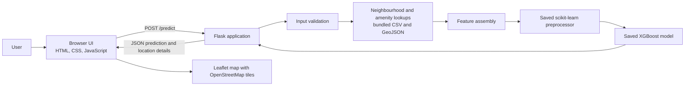

# Toronto House Price Prediction

A Flask web application that estimates Toronto property prices with a trained XGBoost regression model. It combines property details with location-derived amenity and neighbourhood features, then displays the estimate and nearby points on an interactive map.

> This project is an educational prediction tool, not a property valuation, appraisal, or financial recommendation.

## Project Overview

House prices depend on more than a property's size and room count. This project demonstrates a data-driven approach that incorporates property characteristics, Toronto neighbourhoods, and proximity to local amenities. Users provide a few details and a location, and the application returns an estimated price and contextual location information.

## Problem and Solution

Manual comparisons can overlook location factors or apply them inconsistently. The application uses a trained regression model and a repeatable feature pipeline to estimate a price from property inputs and nearby amenities. The browser UI sends a request to the Flask backend, which validates the inputs, calculates location features from the bundled datasets, runs the saved model, and returns a JSON result.

## Key Features

- Estimate a property's price and price per square foot.
- Accept bedrooms, bathrooms, estimated area, home type, latitude, and longitude.
- Choose a location by clicking the map or entering coordinates.
- Calculate distances to the nearest school, hospital, park, library, bank, pharmacy, grocery store, and subway station.
- Count restaurants within 1 km, and schools and parks within 2 km.
- Resolve a Toronto neighbourhood from the bundled boundary data.
- Display nearby amenities on a Leaflet map with a responsive dashboard and light/dark theme toggle.
- Expose JSON prediction and health-check endpoints.

## Technology Stack

| Area | Technologies |
| --- | --- |
| Backend | Python, Flask |
| Data processing | pandas, NumPy, GeoPandas, Shapely |
| Machine learning | scikit-learn preprocessing, XGBoost regression, joblib model loading |
| Geospatial lookup | scikit-learn `BallTree` with haversine distances; GeoPandas spatial joins |
| Frontend | HTML, CSS, JavaScript, Bootstrap 5 |
| Mapping | Leaflet.js, OpenStreetMap tiles |
| Data and artifacts | CSV, GeoJSON, serialized model and preprocessing files |

Bootstrap, Bootstrap Icons, Leaflet, and web fonts are loaded by the page from external CDNs. Map tiles are requested from OpenStreetMap; these resources require network access in the browser.

## System Architecture



## Prediction Workflow

1. The user enters property details and selects a location on the map or enters coordinates.
2. The browser sends the inputs as JSON to `POST /predict`.
3. Flask validates the values and calculates amenity distances, nearby amenity counts, and a neighbourhood.
4. The backend builds the model's feature row and applies the saved preprocessing pipeline.
5. The XGBoost model predicts a price.
6. Flask returns the prediction, price per square foot, neighbourhood, amenity information, timestamp, and nearby map points.
7. The browser updates the result panel and map.

## Repository Structure

```text
.
├── app.py
├── requirements.txt
├── PROJECT_SUMMARY.md
├── data/
│   ├── cleaned data/       # Amenity and property CSVs used by the app
│   ├── processed/          # ML dataset and train/test data
│   ├── raw/                # Source CSV and GeoJSON files
│   └── toronto_real_estate_public_area.csv
├── models/                 # Trained regressors and preprocessing artifacts
├── outputs/                # Evaluation metrics, predictions, and plots
├── scripts/                # Data preparation, preprocessing, training, evaluation
├── static/
│   ├── css/style.css
│   └── js/script.js
└── templates/index.html
```

The application loads the following files when `app.py` starts:

- `models/preprocessor.pkl`
- `models/best_model.pkl` (the app prefers `best_model_tuned.pkl` if present)
- `models/original_features.pkl`
- Cleaned amenity CSVs in `data/cleaned data/`
- Neighbourhood and subway GeoJSON files in `data/raw/`

These artifacts and datasets are included in the repository. Keep the expected filenames and directory layout if replacing them.

## Installation and Setup

### Prerequisites

- Python 3.10 or newer.
- Git.
- Network access in the browser for the external frontend libraries, fonts, and map tiles.

Clone the repository and enter its directory:

```bash
git clone https://github.com/2005KAl/AI-PRICE-PREDICTION-.git
cd AI-PRICE-PREDICTION-
```

Create and activate a virtual environment.

Windows:

```powershell
py -m venv .venv
.\.venv\Scripts\Activate.ps1
```

macOS or Linux:

```bash
python3 -m venv .venv
source .venv/bin/activate
```

Install the listed dependencies and XGBoost, which is needed to load the saved prediction model:

```bash
python -m pip install --upgrade pip
python -m pip install -r requirements.txt
python -m pip install xgboost
```

There is no database setup, API key, or environment variable required by the current application.

## Running the Application

Start the Flask application from the repository root:

```bash
python app.py
```

Open [http://127.0.0.1:5000/](http://127.0.0.1:5000/) in a browser. The application uses Flask's built-in development server; do not use its debug-mode configuration as a production deployment.

## Usage

1. Open the application in a browser.
2. Enter the number of bedrooms and bathrooms, estimated area in square feet, and home type.
3. Set the property's latitude and longitude directly, or click the map to fill them.
4. Select **Predict Price**.
5. Review the estimated price, price per square foot, neighbourhood, amenity distances and counts, and nearby markers.

Supported home types are `Detached`, `Semi Detached`, `Townhouse`, `House`, `Condo`, `Duplex`, `Triplex`, and `Fourplex`.

## API

The prediction endpoint accepts JSON or form data. The browser sends JSON.

| Method | Endpoint | Description |
| --- | --- | --- |
| `GET` | `/` | Serves the prediction interface. |
| `GET` | `/health` | Returns a basic application/model status. |
| `POST` | `/predict` | Validates inputs, computes location features, and returns a price estimate. |

### `POST /predict`

Required JSON fields:

```json
{
  "Bedrooms": 3,
  "Bathrooms": 2,
  "EstimatedArea": 1500,
  "HomeType": "Detached",
  "Latitude": 43.6532,
  "Longitude": -79.3832
}
```

Bedrooms and bathrooms must be non-negative numbers; estimated area must be greater than zero. Home type must be one of the supported values above. Latitude and longitude must be within the valid global coordinate ranges. The application is trained around Toronto data, so coordinates outside Toronto do not produce a meaningful Toronto estimate.

A successful response (`200`) contains:

- `predicted_price`, `predicted_price_formatted`, and `price_per_sqft`
- `estimated_area_sqft`, `home_type`, `bedrooms`, and `bathrooms`
- `neighbourhood`, `model_name`, and `prediction_timestamp`
- `distance_school`, `distance_hospital`, `distance_park`, `distance_library`, `distance_bank`, `distance_pharmacy`, `distance_grocery`, and `distance_subway` (kilometres)
- `restaurants`, `parks`, and `schools` (nearby counts)
- `property_latitude`, `property_longitude`, and `nearby_points`
- `prediction_accuracy` (a fixed value described under [Results and Performance](#results-and-performance))

Invalid input and exceptions during prediction are returned as JSON with an `error` field and HTTP `400`. The endpoint does not require authentication.

### `GET /health`

Returns `200` with a JSON object containing `status` and `model`. This checks that the route responds; it is not a comprehensive readiness check of every dependency.

## Machine Learning

### Inputs and feature engineering

The model predicts `price`. Training features include property and location characteristics such as home type, coordinates, bedrooms, bathrooms, estimated area, neighbourhood, distances to nearby amenities, and counts of selected amenities. At inference time, amenity and neighbourhood features are calculated from the included datasets rather than entered by the user.

The application uses haversine distance with a `BallTree` to find nearby amenities and GeoPandas spatial joins to resolve a neighbourhood. The saved scikit-learn preprocessor imputes missing numerical values with the median, scales numerical features, imputes missing categorical values with the most frequent category, and one-hot encodes categorical values while ignoring unknown categories.

### Training and inference

The training scripts compare Linear Regression, Decision Tree, Random Forest, XGBoost, and LightGBM regressors. The checked-in comparison reports XGBoost as the best model by RMSE, and `models/best_model.pkl` is loaded by the web application. The preprocessor and model are serialized with joblib.

The scripts in `scripts/` are provided for data preparation and model experimentation. The saved artifacts are used for normal app startup; retraining is not required to run the application.

To rerun preprocessing, training, and evaluation using the included processed dataset, install the additional training/evaluation libraries and run these commands from the repository root:

```bash
python -m pip install xgboost lightgbm matplotlib
python scripts/preprocessing.py
python scripts/train_model.py
python scripts/evaluate.py
```

The preprocessing step creates the train/test files and preprocessing artifacts. Training writes model artifacts and comparison results; evaluation writes metrics and plots under `outputs/`.

## Results and Performance

The checked-in evaluation output reports the following metrics for the selected XGBoost model on the test data:

| Metric | Value |
| --- | ---: |
| MAE | 231,733.60 |
| RMSE | 588,055.21 |
| R² | 0.8499 |
| MAPE | 14.23% |

These are evaluation results recorded in `outputs/evaluation_metrics.csv`, not a guarantee of accuracy for an individual property or for current market prices. The API's `prediction_accuracy` field is hard-coded to `84.99%`, corresponding approximately to the recorded R² expressed as a percentage; it is not a per-prediction confidence score or a conventional accuracy metric for regression.

Additional evaluation artifacts, including a model comparison, predictions, feature-importance output, and plots, are available in `outputs/`.

## Error Handling and Security

- The prediction route checks required values, supported home types, non-negative bedroom and bathroom counts, positive area, and valid coordinate ranges.
- Prediction failures are returned as JSON error messages with HTTP `400`; the frontend displays the message.
- There is no authentication, authorization, or database integration.
- Run the built-in debug server only for local development. A production deployment should use an appropriate WSGI server and review error handling and configuration before being exposed publicly.
- Treat the estimate as informational; it is not professional real-estate or financial advice.

## Testing

No automated test suite is included in the repository. The model evaluation scripts under `scripts/` generate metrics and plots, but they are not a substitute for automated application or API tests.

## Technical Highlights

- Combines tabular property information with geospatially derived location features at inference time.
- Uses haversine `BallTree` lookups for efficient nearest-amenity distances and counts.
- Applies a persisted preprocessing pipeline so inference uses the same transformations as training.
- Keeps the browser-facing application and prediction API in one Flask service.

## Limitations and Future Improvements

Current limitations:

- The training and amenity data are specific to Toronto and may not represent other markets or current prices.
- Input coordinates are checked against global bounds, not restricted to Toronto.
- The displayed `prediction_accuracy` value is static and represents the test-set R² approximately, not an individual prediction's confidence.
- The application depends on bundled datasets and model artifacts being present at their expected paths.
- Some browser assets and map tiles are served by external providers.
- The dependency list in `requirements.txt` does not include XGBoost, which is needed to load the checked-in model.

Possible future work:

- Add automated tests for validation, API responses, feature generation, and model loading.
- Replace the static accuracy display with clearly labelled, validated evaluation information.
- Add geographic bounds and more explicit error handling for unsupported locations or unavailable input data.
- Record data provenance and update dates, and evaluate model quality on a documented, representative holdout set.
- Add a production deployment configuration and pin model/runtime dependencies for reproducibility.
